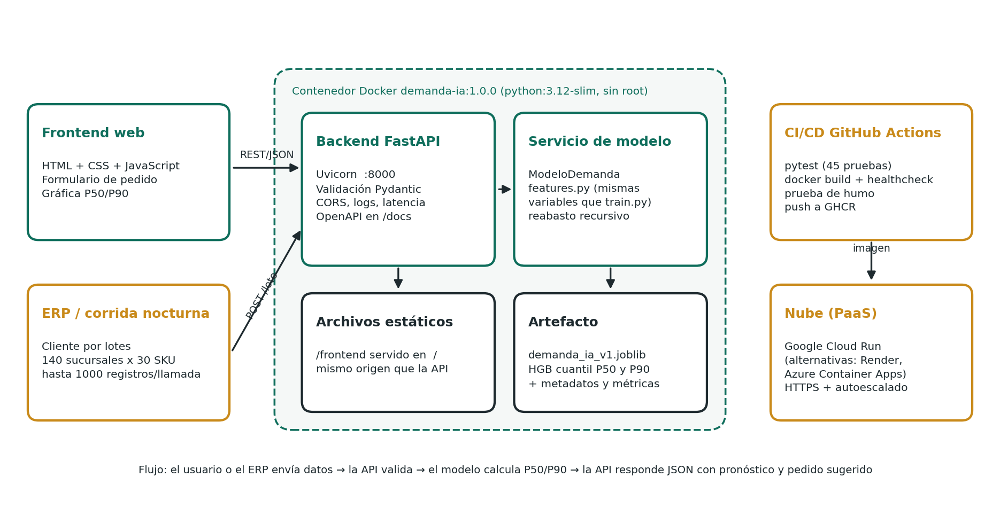

# DEMANDA-IA

Pronóstico de demanda diaria por SKU y sucursal para **Farmacias Occidente Salud** (140 sucursales en el occidente de México). El sistema calcula cuántas piezas conviene pedir para cubrir de 1 a 14 días y entrega el resultado por API REST y por una interfaz web sencilla.

Proyecto Fase II de la materia *Gestión de proyectos de inteligencia artificial*, Master Inteligencia Artificial, Universidad Tecmilenio.



## Qué hace

| Componente | Tecnología | Detalle |
|---|---|---|
| Modelo | scikit-learn `HistGradientBoostingRegressor` | Dos modelos de cuantiles: P50 (venta esperada) y P90 (escenario alto para stock de seguridad) |
| Backend | FastAPI + Uvicorn | Validación con Pydantic, CORS configurable, log de latencia por petición |
| Frontend | HTML, CSS y JavaScript sin dependencias externas | Formulario de pedido, gráfica de historial y pronóstico, tabla diaria |
| Contenedor | Docker multi-etapa sobre `python:3.12-slim` | Usuario sin privilegios, `HEALTHCHECK`, puerto configurable con `$PORT` |
| CI/CD | GitHub Actions | pytest, build de imagen, healthcheck, prueba de humo y publicación en GHCR |

Los datos son sintéticos. El simulador (`src/demanda_ia/data.py`) reproduce estacionalidad por categoría, quincenas, festivos de la LFT, promociones, elasticidad al precio y quiebres de stock.

## Inicio rápido con Docker

```bash
git clone https://github.com/gerardortizle/demanda-ia.git
cd demanda-ia
docker build -t demanda-ia:1.0.0 .
docker run -d --name demanda -p 8000:8000 demanda-ia:1.0.0
docker ps                      # STATUS debe decir (healthy) después de ~20 s
./scripts/smoke_test.sh        # en Windows: .\scripts\smoke_test.ps1

En caso de que falle este comando usar:
powershell -ExecutionPolicy Bypass -File .\scripts\smoke_test.ps1

> **Nota (Windows):** PowerShell bloquea por defecto la ejecución de scripts `.ps1`.
> El comando : powershell -ExecutionPolicy Bypass -File .\scripts\smoke_test.ps1 usa
> `-ExecutionPolicy Bypass` para ejecutar únicamente este script sin modificar la 
> configuración del sistema.
```

Luego abre:

- Interfaz web: http://localhost:8000/
- Documentación interactiva (Swagger): http://localhost:8000/docs
- Estado del servicio: http://localhost:8000/api/v1/salud

Con Docker Compose: `docker compose up --build`.

Para correr la suite de pruebas dentro del build: `docker build --target pruebas -t demanda-ia:test .`

## Endpoints

| Método | Ruta | Uso |
|---|---|---|
| GET | `/api/v1/salud` | Estado del servicio y versión del modelo |
| GET | `/api/v1/modelo` | Metadatos, variables y métricas de evaluación |
| GET | `/api/v1/catalogo` | Sucursales, SKUs y límites de la API |
| GET | `/api/v1/historial` | Últimos 28 días de venta simulada (solo demo) |
| POST | `/api/v1/pronostico` | Pronóstico de un día para un par sucursal-SKU |
| POST | `/api/v1/pronostico/lote` | Hasta 1000 pronósticos por llamada (corrida nocturna del ERP) |
| POST | `/api/v1/reabasto` | Pronóstico de 1 a 14 días y pedido sugerido |

Ejemplo:

```bash
Linux/macOS (bash)
curl -X POST http://localhost:8000/api/v1/pronostico \
  -H "Content-Type: application/json" \
  -d '{"sucursal_id":"SUC-001","sku":"SKU-0005","fecha":"2026-12-15","lag_7":12,"media_7":11,"media_28":10}'

Windows (PowerShell)
curl.exe -X POST "http://localhost:8000/api/v1/pronostico" -H "Content-Type: application/json" -d '{\"sucursal_id\":\"SUC-001\",\"sku\":\"SKU-0005\",\"fecha\":\"2026-12-15\",\"lag_7\":12,\"media_7\":11,\"media_28\":10}'
```

```json
{"sucursal_id":"SUC-001","sku":"SKU-0005","fecha":"2026-12-15","pronostico_p50":12.51,
 "pronostico_p90":23.51,"unidades_sugeridas":24,"advertencias":[],"modelo_version":"1.0.0"}
```

## Desarrollo sin Docker

```bash
python -m venv .venv && source .venv/bin/activate      # Windows: .venv\Scripts\activate
pip install -r requirements-dev.txt
PYTHONPATH=src python -m demanda_ia.train               # reentrena (~75 s) y regenera models/ y reports/
PYTHONPATH=src python -m pytest -v                       # 45 pruebas
PYTHONPATH=src uvicorn demanda_ia.api:app --reload       # servidor local
PYTHONPATH=src python scripts/generar_reportes.py        # figuras del documento de validación
```

En PowerShell, en lugar de `PYTHONPATH=src ...` usa `$env:PYTHONPATH="src"` antes del comando.

## Resultados del modelo

| Conjunto | WAPE diario | Ingenuo lag 7 | Media 28 días | WAPE semanal | Cobertura P90 |
|---|---|---|---|---|---|
| Prueba temporal (oct-dic 2025) | 46.2 % | 66.9 % | 49.0 % | 20.1 % | 88.8 % |
| 10 sucursales no vistas | 45.8 % | 65.7 % | 48.1 % | 21.5 % | 88.4 % |

El WAPE diario parece alto, pero coincide con el de un "oráculo" que conoce la media real del simulador (46.3 %). Ese error viene del ruido propio de vender pocas piezas por día. A nivel semanal, que es el horizonte que importa para el pedido, el error baja a 20 %. Detalle completo en `docs/Documento_Validacion_Pruebas_DEMANDA-IA.docx`.

## Estructura

```
demanda-ia/
├── src/demanda_ia/        config, data (simulador), features, train, model, schemas, api
├── frontend/              index.html, styles.css, app.js
├── models/                demanda_ia_v1.joblib + metadatos .json
├── tests/                 pruebas funcionales, casos extremos y del modelo
├── scripts/               smoke_test.sh/.ps1, benchmark.py, generar_reportes.py, diagrama_arquitectura.py
├── reports/               métricas, sensibilidad, resultados de pruebas, figuras
├── .github/workflows/     ci.yml
├── Dockerfile, docker-compose.yml, .dockerignore, .env.example
└── requirements.txt, requirements-dev.txt
```
### Modelo entrenado

El modelo de DEMANDA-IA se encuentra en la carpeta `models/`:

| Archivo | Descripción |
|---|---|
| `demanda_ia_v1.joblib` | Modelo entrenado y serializado con `joblib`. Es el archivo que carga la API al iniciar. |
| `demanda_ia_v1.json` | Metadata del modelo: [orden de las variables de entrada, versión, métricas de evaluación y fecha de entrenamiento]. |

**¿Por qué `.joblib` y no `.pkl`?** El tutorial de contenerización contempla varios formatos de serialización (`.pkl`, `.joblib`, `.h5`, `.pt`, `.onnx`). Se eligió `joblib` porque es el formato recomendado por 
scikit-learn: almacena de forma más eficiente los arreglos de NumPy que forman el modelo y produce archivos más ligeros y rápidos de cargar. Funcionalmente cumple el mismo papel que el `model.pkl` del tutorial.

> **Importante:** el modelo debe cargarse con la misma versión de scikit-learn con la que fue entrenado (`scikit-learn==[1.x.x]`, fijada en `requirements.txt`). Usar otra versión puede producir advertencias de incompatibilidad o errores al deserializar.

## Despliegue en la nube

La estrategia elegida es contenedor sobre PaaS (Google Cloud Run), con la imagen publicada por el CI en GitHub Container Registry. El paso a paso, los requerimientos y las alternativas (Render, Azure Container Apps) están en `Fase II. Manual de despliegue DEMANDA-IA.docx`.

## Limitaciones conocidas

- Datos sintéticos: las métricas validan el pipeline, no el desempeño con ventas reales.
- El P50 subestima la suma semanal en torno a 11 %, porque la mediana de una venta sesgada queda por debajo de la media. El stock de seguridad lo compensa en el pedido sugerido.
- El modelo no vio precios por arriba del de lista. La API acota el precio y lo avisa en `advertencias`.
- La API no tiene autenticación. En producción debe ir detrás de IAM o de un API gateway.

## Autor

José Gerardo Ortiz Leñero. Profesora: Ing. Tania Judith Mendoza Torres.
