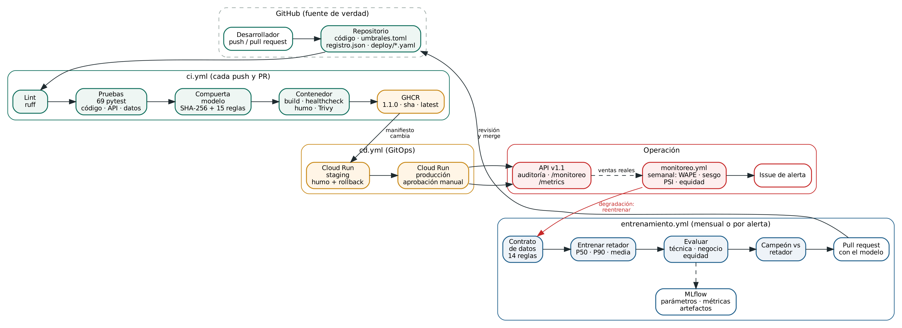

# DEMANDA-IA

Pronóstico de demanda diaria por SKU y sucursal para **Farmacias Occidente Salud** (140 sucursales en el occidente de México). El sistema calcula cuántas piezas conviene pedir para cubrir de 1 a 14 días y entrega el resultado por API REST y por una interfaz web sencilla.

Proyecto de la materia *Gestión de proyectos de inteligencia artificial*, Master Inteligencia Artificial, Universidad Tecmilenio. Fase I: caso de negocio. Fase II: API, contenedor y despliegue. **Fase III (v1.1.0): pipeline MLOps/GitOps con entrenamiento continuo, versionado de modelos, monitoreo y auditoría.**

[](https://github.com/gerardortizle/demanda-ia/actions/workflows/ci.yml)
[](https://github.com/gerardortizle/demanda-ia/actions/workflows/monitoreo.yml)



## Fase III en una tabla

| Práctica | Dónde | Qué hace |
|---|---|---|
| Integración continua | `.github/workflows/ci.yml` | ruff, 69 pruebas (código, API, contrato de datos, registro, monitoreo), compuerta del modelo, build, healthcheck, humo, Trivy y publicación en GHCR |
| Pruebas de datos | `src/demanda_ia/validacion_datos.py` | 14 reglas: esquema, nulos, duplicados, catálogos, rangos, continuidad de series y desabasto |
| Entrenamiento continuo | `.github/workflows/entrenamiento.yml`, `src/demanda_ia/pipeline.py` | Datos → entrenamiento → evaluación técnica, de negocio y de equidad → 15 compuertas → campeón vs retador → pull request con el modelo |
| Versionado de modelos | `models/registro.json`, MLflow | SHA-256, huella de datos, commit, hiperparámetros, métricas y etapa de cada versión |
| Despliegue continuo GitOps | `.github/workflows/cd.yml`, `deploy/` | Manifiestos de Cloud Run (staging y producción con aprobación) como fuente de verdad; humo y rollback automático. Alternativa Kubernetes + Argo CD |
| Monitoreo | `src/demanda_ia/monitoreo.py`, `.github/workflows/monitoreo.yml`, `/api/v1/monitoreo`, `/metrics` | WAPE y sesgo semanal, cobertura P90, PSI, equidad; issue automático y reentrenamiento |
| Auditoría | `src/demanda_ia/auditoria.py`, `/api/v1/auditoria` | Un evento por inferencia con id de petición, versión y hash del modelo, entrada y salida |
| Umbrales | `config/umbrales.toml` | Metas de la Fase I en un solo archivo versionado |
| Decisiones | `docs/adr/`, `MODEL_CARD.md`, `CHANGELOG.md` | Por qué se eligió cada cosa |

## Qué hace

| Componente | Tecnología | Detalle |
|---|---|---|
| Modelo | scikit-learn `HistGradientBoostingRegressor` | Dos modelos de cuantiles: P50 (venta esperada) y P90 (escenario alto para stock de seguridad) |
| Backend | FastAPI + Uvicorn | Validación con Pydantic, CORS configurable, log de latencia por petición |
| Frontend | HTML, CSS y JavaScript sin dependencias externas | Formulario de pedido, gráfica de historial y pronóstico, tabla diaria |
| Contenedor | Docker multi-etapa sobre `python:3.12-slim` | Usuario sin privilegios, `HEALTHCHECK`, puerto configurable con `$PORT` |
| CI/CD | GitHub Actions | pytest, build de imagen, healthcheck, prueba de humo y publicación en GHCR |

Los datos son sintéticos. El simulador (`src/demanda_ia/data.py`) reproduce estacionalidad por categoría, quincenas, festivos de la LFT más 24 y 31 de diciembre, promociones, elasticidad al precio y quiebres de stock.

## Inicio rápido con Docker

```bash
git clone https://github.com/gerardortizle/demanda-ia.git
cd demanda-ia
docker build -t demanda-ia:1.1.0 .
docker run -d --name demanda -p 8000:8000 demanda-ia:1.1.0
docker ps                      # STATUS debe decir (healthy) después de ~30 a 60 s
./scripts/smoke_test.sh        # en Windows: .\scripts\smoke_test.ps1
```
En caso de que falle este comando usar:
powershell -ExecutionPolicy Bypass -File .\scripts\smoke_test.ps1

> **Nota (Windows):** PowerShell bloquea por defecto la ejecución de scripts `.ps1`.
> El comando : powershell -ExecutionPolicy Bypass -File .\scripts\smoke_test.ps1 usa
> `-ExecutionPolicy Bypass` para ejecutar únicamente este script sin modificar la 
> configuración del sistema.

Luego abre:

- Interfaz web: http://localhost:8000/
- Documentación interactiva (Swagger): http://localhost:8000/docs
- Estado del servicio: http://localhost:8000/api/v1/salud

Con Docker Compose: `docker compose up --build`.

Para correr la suite de pruebas dentro del build: `docker build --target pruebas -t demanda-ia:test .`

## Endpoints

| Método | Ruta | Uso |
|---|---|---|
| GET | `/api/v1/salud` | Estado del servicio y versión del modelo |
| GET | `/api/v1/modelo` | Metadatos, variables y métricas de evaluación |
| GET | `/api/v1/catalogo` | Sucursales, SKUs y límites de la API |
| GET | `/api/v1/historial` | Últimos 28 días de venta simulada (solo demo) |
| POST | `/api/v1/pronostico` | Pronóstico de un día para un par sucursal-SKU |
| POST | `/api/v1/pronostico/lote` | Hasta 1000 pronósticos por llamada (corrida nocturna del ERP) |
| POST | `/api/v1/reabasto` | Pronóstico de 1 a 14 días y pedido sugerido |
| GET | `/api/v1/monitoreo` | Latencias, códigos, tasa de advertencias y alertas de la instancia (v1.1) |
| GET | `/api/v1/auditoria` | Últimos eventos de auditoría de inferencia (v1.1) |
| GET | `/metrics` | Métricas en formato Prometheus (v1.1) |

Ejemplo:

```bash
Linux/macOS (bash)
curl -X POST http://localhost:8000/api/v1/pronostico \
  -H "Content-Type: application/json" \
  -d '{"sucursal_id":"SUC-001","sku":"SKU-0005","fecha":"2026-12-15","lag_7":12,"media_7":11,"media_28":10}'

Windows (PowerShell)
curl.exe -X POST "http://localhost:8000/api/v1/pronostico" -H "Content-Type: application/json" -d '{\"sucursal_id\":\"SUC-001\",\"sku\":\"SKU-0005\",\"fecha\":\"2026-12-15\",\"lag_7\":12,\"media_7\":11,\"media_28\":10}'
```

```json
{"sucursal_id":"SUC-001","sku":"SKU-0005","fecha":"2026-12-15","pronostico_p50":12.51,
 "pronostico_p90":23.51,"unidades_sugeridas":24,"advertencias":[],"modelo_version":"1.0.0"}
```

## Desarrollo sin Docker

```bash
python -m venv .venv && source .venv/bin/activate      # Windows: .venv\Scripts\activate
pip install -r requirements-dev.txt
PYTHONPATH=src python -m demanda_ia.train               # reentrena (~75 s) y regenera models/ y reports/
PYTHONPATH=src python -m pytest -v                       # 45 pruebas
PYTHONPATH=src uvicorn demanda_ia.api:app --reload       # servidor local
PYTHONPATH=src python scripts/generar_reportes.py        # figuras del documento de validación
```

### Pipeline MLOps local (Fase III)

```bash
pip install -r requirements-mlops.txt                                   # agrega MLflow
PYTHONPATH=src python scripts/experimentos.py --mlflow                  # búsqueda de hiperparámetros (validación interna)
PYTHONPATH=src python -m demanda_ia.pipeline --version 1.1.0 --mlflow --promover
PYTHONPATH=src python -m demanda_ia.registro listar                     # versiones, etapa y hash
PYTHONPATH=src python -m demanda_ia.registro promover 1.0.0 --motivo "rollback"   # regresar de modelo
PYTHONPATH=src python scripts/verificar_modelo.py                       # la misma compuerta que corre el CI
PYTHONPATH=src python -m demanda_ia.monitoreo --escenario brote_respiratorio      # base | brote_respiratorio | competidor_jalisco | alza_precios
mlflow ui --backend-store-uri sqlite:///mlflow.db                      # http://localhost:5000
```

Para regresar de modelo sin reconstruir la imagen: `docker run -e MODEL_PATH=/app/models/demanda_ia_v1.joblib ...` (la imagen trae las versiones registradas).

En PowerShell, en lugar de `PYTHONPATH=src ...` usa `$env:PYTHONPATH="src"` antes del comando.

## Resultados del modelo

v1.1.0 (campeón) contra v1.0.0 (Fase II), mismos datos, solo semanas completas:

| Conjunto | WAPE semanal v1.0 | WAPE semanal v1.1 | Sesgo v1.0 | Sesgo v1.1 | Cobertura P90 | Nivel de servicio simulado | Equidad v1.1 |
|---|---|---|---|---|---|---|---|
| Prueba temporal (oct-dic 2025) | 19.7 % | **17.8 %** | −11.3 % | **−2.9 %** | 88.8 % | 97.8 % | 1.22 |
| 10 sucursales no vistas | 20.9 % | **19.3 %** | −14.0 % | **−7.8 %** | 88.4 % | 96.8 % | 1.24 |

Resultados de la Fase II (incluían semanas parciales, por eso el WAPE semanal era 20.1 % y 21.5 %):

| Conjunto | WAPE diario | Ingenuo lag 7 | Media 28 días | WAPE semanal | Cobertura P90 |
|---|---|---|---|---|---|
| Prueba temporal (oct-dic 2025) | 46.2 % | 66.9 % | 49.0 % | 20.1 % | 88.8 % |
| 10 sucursales no vistas | 45.8 % | 65.7 % | 48.1 % | 21.5 % | 88.4 % |

El WAPE diario parece alto, pero coincide con el de un "oráculo" que conoce la media real del simulador (46.3 %). Ese error viene del ruido propio de vender pocas piezas por día. A nivel semanal, que es el horizonte que importa para el pedido, el error baja a 20 %. Detalle completo en `docs/Fase II. Documento de validación de pruebas DEMANDA-IA JGOL.docx`.

## Estructura

```
demanda-ia/
├── src/demanda_ia/        config, data (simulador), features, train, model, schemas, api,
│                          evaluacion, validacion_datos, pipeline, registro, monitoreo, auditoria
├── config/                umbrales.toml (compuertas y alertas)
├── deploy/                cloudrun/ (staging, produccion), k8s/ (Kustomize), argocd/
├── frontend/              index.html, styles.css, app.js
├── models/                registro.json, demanda_ia_v1.joblib (1.0.0), demanda_ia_1.1.0.joblib + metadatos
├── tests/                 pruebas funcionales, casos extremos y del modelo
├── scripts/               smoke_test.sh/.ps1, benchmark.py, generar_reportes.py, diagrama_arquitectura.py
├── reports/               métricas, sensibilidad, resultados de pruebas, figuras
├── docs/                  manual de despliegue y documento de validación
├── .github/workflows/     ci.yml, entrenamiento.yml, monitoreo.yml, cd.yml
├── Dockerfile, docker-compose.yml, .dockerignore, .env.example
└── requirements.txt, requirements-dev.txt
```
### Modelo entrenado

El modelo de DEMANDA-IA se encuentra en la carpeta `models/`:

| Archivo | Descripción |
|---|---|
| `registro.json` | Registro de versiones (Fase III). Su campo `campeon` decide qué artefacto carga la API al iniciar |
| `demanda_ia_1.1.0.joblib` | Campeón actual: P50, P90 y media (Poisson) |
| `demanda_ia_v1.joblib` | Modelo 1.0.0 de la Fase II, archivado; se conserva para rollback |
| `demanda_ia_v1.json` | Metadatos del modelo: nombre, versión, algoritmo, lista ordenada de las 15 variables, versión de scikit-learn, fecha de entrenamiento, periodos de entrenamiento y prueba, sucursales de entrenamiento y holdout, y métricas de evaluación |

**¿Por qué `.joblib` y no `.pkl`?** El tutorial de contenerización contempla varios formatos de serialización (`.pkl`, `.joblib`, `.h5`, `.pt`, `.onnx`). Se eligió `joblib` porque es el formato recomendado por 
scikit-learn: almacena de forma más eficiente los arreglos de NumPy que forman el modelo y produce archivos más ligeros y rápidos de cargar. Funcionalmente cumple el mismo papel que el `model.pkl` del tutorial.

> **Importante:** el modelo debe cargarse con la misma versión de scikit-learn con la que fue entrenado (`scikit-learn==1.8.0`, fijada en `requirements.txt`). Usar otra versión puede producir advertencias de incompatibilidad o errores al deserializar.

## Despliegue en la nube

La estrategia elegida es contenedor sobre PaaS (Google Cloud Run), con la imagen publicada por el CI en GitHub Container Registry. El paso a paso, los requerimientos y las alternativas (Render, Azure Container Apps) están en `docs/Fase II. Manual de despliegue DEMANDA-IA JGOL.docx`.

Demo en línea: https://demanda-ia-874563229975.us-central1.run.app (documentación de la API en https://demanda-ia-874563229975.us-central1.run.app/docs).

## Limitaciones conocidas

- Datos sintéticos: las métricas validan el pipeline, no el desempeño con ventas reales.
- El P50 subestima la suma semanal (−11 % a −14 %). Desde v1.1 se publica además la media sin sesgo para planear compras; el pedido sigue usando P50 + stock de seguridad porque el backtest mostró que da el mismo servicio con menos inventario (`docs/adr/ADR-004`).
- El reentrenamiento usa la ventana fija 2024-2025 del simulador; con datos reales la ventana debe moverse con cada corrida.
- El modelo no vio precios por arriba del de lista. La API acota el precio y lo avisa en `advertencias`.
- La API no tiene autenticación. En producción debe ir detrás de IAM o de un API gateway.
- El calendario de festivos no incluye el 1 de octubre de los años de transmisión del Poder Ejecutivo Federal (por ejemplo, 2024), que sí es descanso obligatorio según el art. 74 de la LFT.

## Autor

José Gerardo Ortiz Leñero. Profesora: Ing. Tania Judith Mendoza Torres.
